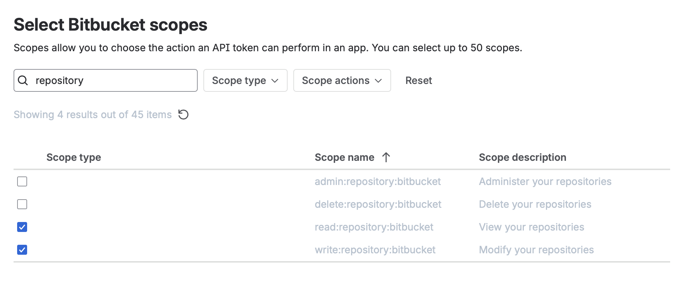

Mirrors a GitHub Git repository to Bitbucket.

**BREAKING CHANGE, users of previous version, please notice**: V3 of this action uses Bitbucket's scoped API tokens and no longer supports credential check and repository creation.

## Required Inputs

### `password`

Password to use on Bitbucket for authentication and for pushing. **Create a new [Scoped API Token](https://id.atlassian.com/manage-profile/security/api-tokens) for Bitbucket with the following permissions:**



```
Read
read:repository: bitbucket

Write
write:repository bitbucket
```

## Optional Inputs

### `username`

Username to use on Bitbucket for 1) authentication and as 2) workspace name. Default: GitHub user name.

### `repository`

Name of the repository on Bitbucket. If it does not exist, it is created automatically. Default: GitHub repository name.

### `spacename`

Name of the space in which the repository should be contained on Bitbucket. Default: GitHub user name.

## Outputs

None

## Example usage

      - name: Checkout
        uses: actions/checkout@v2
        with:
          fetch-depth: 0 # <-- clone with complete history
      - name: Push
        uses: heussd/mirror-to-bitbucket-github-action@v3
        with:
          password: ${{ secrets.BITBUCKET_PASSWORD }}

## Example with all parameters

      - name: Checkout
        uses: actions/checkout@v2
        with:
          fetch-depth: 0 # <-- clone with complete history
      - name: Push
        uses: heussd/mirror-to-bitbucket-github-action@v3
        with:
          username: mycrazybbusername
          spacename: teamspace
          repository: bestrepo
          password: ${{ secrets.BITBUCKET_PASSWORD }}
